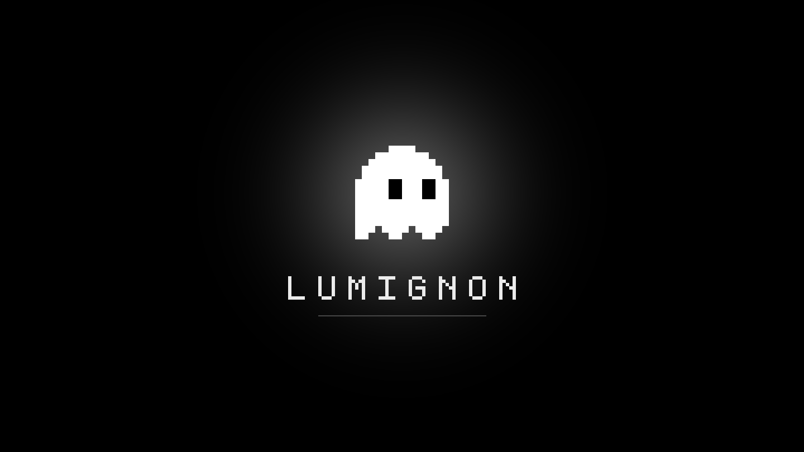
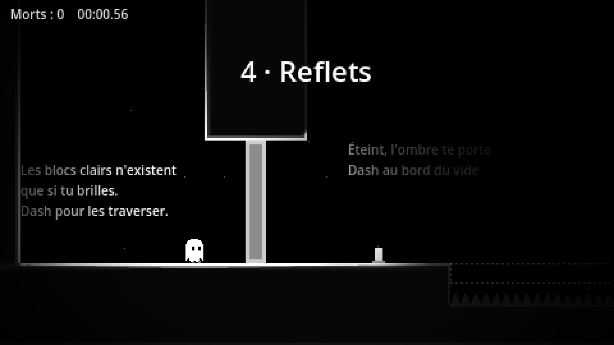
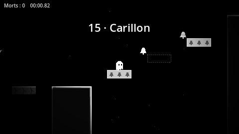
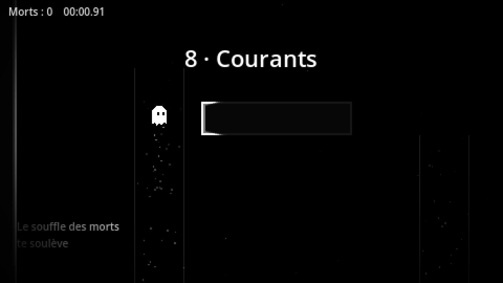
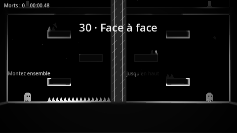
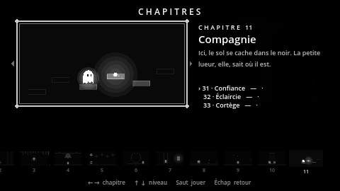

  

# Lumignon

*Une petite lueur, et tout le noir autour.*

Un **lumignon**, c'est le bout de mèche qui brûle encore quand la bougie est presque finie.
Tu en es un : la dernière petite flamme d'une vieille tour engloutie par le marais, un petit
fantôme blanc qui doit monter, salle après salle, jusqu'au matin.

Lumignon est un **plateformer de précision** en noir et blanc. Le fantôme est la seule source
de lumière : les murs n'existent que par leur liseré éclairé, et tout le reste se perd dans
l'ombre. Sauts au pixel près, wall jumps, dash dans huit directions, et beaucoup de morts
(c'est normal, la réapparition est immédiate).

## Ce qui t'attend

- **Douze chapitres**, chacun avec sa mécanique, son décor et sa musique : blocs de lumière et
  d'ombre, pierres qui s'effondrent, courants d'air, ressorts, cloches, blocs au rythme d'une
  horloge, une ombre qui te poursuit, des yeux qu'il vaut mieux éviter, un reflet à guider...
- **Des étincelles** cachées hors du chemin, une par niveau. Elles ne sont pas là que pour le score.
- **Des faces B**, plus dures, derrière des passages secrets.
- **Des apparences** à débloquer, des records par niveau et pour la partie complète, des statistiques.
- **Une musique** propre à chaque chapitre, qui s'intensifie au fil de la montée.
- **Des options d'assistance** (vitesse du jeu, dash infini, invincibilité) pour que tout le
  monde puisse aller au bout.

## Captures

  
  

  
  

  
  

## Télécharger et jouer

1. Va dans l'onglet **[Releases](../../releases)** de cette page.
2. Prends la dernière version et télécharge le fichier de ton système, dans la section **Assets** :
   - **Windows** : le `.zip` Windows. Décompresse-le, puis lance `Lumignon.exe`.
   - **Linux** : le `.zip` Linux. Décompresse-le, rends le fichier exécutable
     (`chmod +x Lumignon.x86_64`) puis lance-le.
   - **macOS** : le `.zip` macOS, s'il est proposé. Au premier lancement, fais clic droit > Ouvrir.
3. Aucune installation : le jeu se lance directement.

Windows peut afficher « Windows a protégé votre ordinateur » (le jeu n'est pas signé) :
clique sur **Informations complémentaires** puis **Exécuter quand même**.

Ta progression, tes records et tes réglages sont sauvegardés automatiquement.

## Configuration requise

- Windows 10 ou 11, Linux 64 bits, ou macOS récent.
- Une carte graphique compatible OpenGL 3.3 (n'importe quel PC de moins de dix ans).
- Environ 100 Mo d'espace disque.
- Clavier ou manette.

## Contrôles

| Action | Clavier (AZERTY et QWERTY) | Manette |
|---|---|---|
| Bouger | Flèches, Q/D (ou A/D) | Stick gauche, croix |
| Viser (dash) | Flèches, Z/S (ou W/S) | Stick gauche |
| Sauter | C, Espace, K | A |
| Dash | X, Maj, J | X ou B |
| Retour à la dernière bougie | R | Y |
| Pause | Échap, P, Entrée | Start |

Toutes les touches se changent dans **Options > Touches**, au clavier comme à la manette.

## Quelques conseils

- Maintenir le saut fait monter plus haut ; le relâcher coupe le saut.
- Contre un mur, tu glisses plus lentement, et sauter te repousse de l'autre côté.
- Tu n'as qu'un dash en l'air. Il revient quand tu touches le sol ou un cristal.
  Quand il est épuisé, le fantôme pâlit : sa lumière te dit toujours où tu en es.
- Les bougies sont des points de sauvegarde : touche-les pour les allumer.

---

Lumignon est un jeu fait par **Lumy-57** avec Godot 4. Ce dépôt contient le code source du jeu
et ses versions publiées. Pour ouvrir le projet dans Godot, voir **[docs/developpement.md](docs/developpement.md)**.
Pour signaler un bug ou donner ton avis, ouvre une **[issue](../../issues)**.
