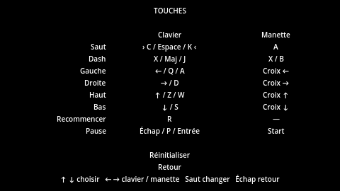
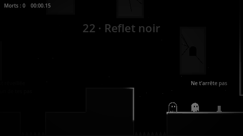
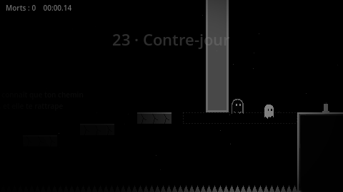
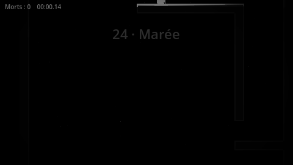
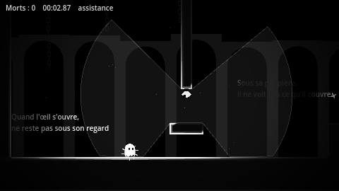
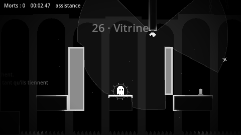
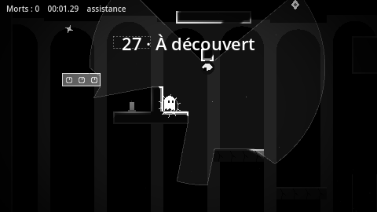
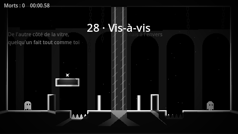
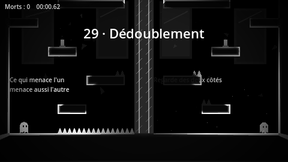

# Lumignon : développement (Godot 4)

*Une petite lueur, et tout le noir autour.*

Plateformer exigeant façon Celeste. Tu incarnes un petit fantôme blanc dans un monde
entièrement noir et blanc : le fantôme est la source de lumière, les murs n'existent
que par leur liseré éclairé, et tout le reste se perd dans l'ombre.

## Lancer le jeu
1. Installer Godot 4.7 ou plus récent (version standard, pas besoin de .NET).
2. Godot > Importer > choisir `project.godot` à la racine du dépôt.
3. F5 pour jouer.

## L'histoire
Le jeu s'appelle **Lumignon** : le bout de mèche qui brûle encore quand la bougie est presque finie.
Tu joues la dernière petite flamme d'une vieille tour engloutie par le marais. Les cartes de chapitre
racontent la montée ; le reste est caché.

**L'histoire cachée** (`scripts/lore.gd`) : chaque étincelle est un fragment d'un journal. La première
fois qu'on trouve l'étincelle d'un niveau, son fragment s'affiche à la sortie, et le **Journal** (écran
titre) garde tous les fragments trouvés, rangés par chapitre. En surface, c'est la vie de quelqu'un
dans une grande tour. Il y a une autre lecture, à deviner en relisant les tournures. Avec toutes les
étincelles, l'épilogue change : c'est la vraie fin.

**Faces B** : chaque chapitre cache une sortie secrète derrière une fausse paroi (`%` dans les
niveaux, un mur qui respire à peine). La prendre finit le niveau et ouvre la face B du chapitre, un
niveau plus dur qu'on lance depuis l'écran Chapitres (ligne « B » sous les niveaux). Les faces B
sont rangées à la fin de `levels/list.tres` (réglage « Bside » du niveau), hors de la partie, du journal et des étincelles.

## Contrôles
| Action | Clavier (AZERTY et QWERTY) | Manette |
|---|---|---|
| Bouger | Flèches, Q/D (ou A/D) | Stick gauche, croix |
| Viser (dash) | Flèches, Z/S (ou W/S) | Stick gauche |
| Sauter | C, Espace, K | A |
| Dash | X, Maj, J | X ou B |
| Retour à la dernière bougie (compte comme une mort) | R | Y |
| Pause, retour à la bougie, recommencer le niveau, choisir un niveau, options | Échap, P, Entrée | Start |

Ce sont les touches par défaut : toutes se changent dans **Options > Touches**, au clavier
comme à la manette (une touche par action ; « Réinitialiser » remet celles-ci). Si la touche
choisie servait déjà à une autre action, les deux s'échangent. Le stick gauche déplace
toujours le fantôme. Touches gardées dans `user://save/controls.cfg`.

## Design
- **Mouvement serré** : accélération rapide, coyote time (0,1 s), buffer de saut (0,12 s),
  saut variable (relâcher coupe la montée), apex adouci quand on maintient saut,
  chute rapide en tenant bas.
- **Wall jump** : glisser contre un mur ralentit la chute, sauter contre un mur repousse.
- **Dash 8 directions** : un seul dash en l'air, rechargé au sol. Petit gel à l'impact,
  direction lue à la fin du gel (comme Celeste), traînée d'images rémanentes,
  secousse d'écran. Sauter pendant un dash au sol garde la vitesse.
- **La lumière raconte l'état** : quand le dash est épuisé, le fantôme pâlit
  et sa lumière faiblit.
- **Blocs de lumière et d'ombre** : les blocs clairs (`L`) n'existent que quand le fantôme
  brille (dash disponible), les blocs hachurés (`O`) seulement quand il est éteint (dash utilisé).
  Dasher fait donc disparaître les uns et apparaître les autres. L'ombre porte le fantôme mais
  ne recharge pas son dash : seul le vrai sol (ou un cristal) le rallume. Un bloc qui devrait
  réapparaître sur le fantôme attend qu'il soit sorti.
- **Pierres fissurées** (`X`) : elles tremblent dès que le fantôme les touche, s'effondrent
  après 0,45 s et reviennent 2 s plus tard.
- **Courants d'air spectraux** (`|`) : des colonnes qui soulèvent le fantôme ; au sommet il plane,
  et peut repartir en dash.
- **Ressorts** (`S`) : propulsent le fantôme vers le haut et lui rendent son dash.
- **Plateformes mobiles** (`M` horizontale, `W` verticale) : font l'aller-retour le long de
  leur rail (`-`), avec une courte pause à chaque bout, et emportent le fantôme.
- **Cloches** (`B`) : toucher une cloche inverse les blocs de carillon. Les blocs clairs (`a`)
  sont solides au repos, les sombres (`b`) une fois la cloche sonnée. On peut sonner en plein
  saut pour changer le sol avant d'atterrir. Chaque bougie retient l'état des cloches.
- **Blocs rythmés** (`1`, `2`) : un métronome commun à tout le niveau. Les blocs `1` sont
  solides pendant la première moitié du cycle (1,2 s), les `2` pendant la seconde. Un bloc
  clignote juste avant de disparaître, et un bloc absent se remplit à mesure qu'il revient.
- **Ombre poursuivante** (`H`) : l'ombre du fantôme s'éveille dès qu'il quitte son point
  d'apparition et refait exactement son chemin avec 1,1 s de retard. La toucher tue :
  s'arrêter plus d'une seconde, c'est se faire rattraper. Elle repart de la bougie après une mort.
- **Marée de ténèbres** (`~`) : sa ligne marque où elle commence. Elle monte dès que le
  fantôme bouge (26 px/s) et accélère si elle est trop loin derrière. Y plonger tue. Après
  une mort, elle repart 6 tuiles sous la bougie.
- **Yeux** (`Y`, `y`) : ils s'ouvrent et se ferment sur un cycle commun au niveau (fermé 1,8 s,
  paupière qui s'entrouvre 0,5 s, ouvert 1,6 s ; `y` est décalé d'un demi-cycle). Ouvert, un œil
  regarde tout autour de lui sur 150 px, et son regard s'arrête aux murs et aux blocs solides
  (un bloc de lumière ne cache que tant que le fantôme brille). Rester 0,55 s dans un regard tue ;
  des cils se resserrent autour du fantôme à mesure que l'exposition monte, et elle retombe à l'abri.
- **Reflet** (`R`) et **vitre** (`=`) : le reflet reçoit les mêmes touches que le fantôme, gauche
  et droite inversées. Si l'un meurt, les deux repartent. Une vitre est un mur qui laisse passer
  la lumière ; un mur qui bloque l'un pendant que l'autre avance permet de les décaler. Chacun
  attend l'autre dans sa sortie, et le niveau finit quand les deux y sont. Si l'un sort de l'écran,
  les deux meurent. Les bougies vont par paires, symétriques par rapport à la vitre : en toucher une
  suffit pour que chacun reparte de la bougie de son côté. La caméra suit le milieu des deux.
  Les options d'assistance (dash infini, invincibilité) valent aussi pour le reflet.
- **Pierres cachées** (`i`) : invisibles et traversables dans le noir. Elles apparaissent et portent
  le fantôme quand la petite orbe passe à moins de 40 px (22 px autour du fantôme lui-même), puis
  s'effacent 0,9 s après. On les traverse par en dessous. Une pierre déjà vue garde un trait pâle.
  Dans ce chapitre, l'orbe éclaire plus fort et, à chaque dash, file 84 px devant dans la direction
  du dash pendant une demi-seconde : c'est elle qui montre où atterrir.
- **Éléments** : pics (mort instantanée), bougies (checkpoints qui s'allument),
  cristaux (rechargent le dash, réapparaissent après 2,5 s), faille de lumière (sortie).
- **Rendu** : CanvasModulate presque noir, PointLight2D avec ombres douces sur le fantôme,
  les bougies, les cristaux et la sortie. Les occulteurs sont légèrement rentrés dans les
  murs pour que leurs bords captent la lumière. Vignette, poussière flottante.
- Résolution interne 480x270, mise à l'échelle x3 en pixels nets.
- **Sensations** : poussière au saut, à l'atterrissage et au wall jump, poussée de caméra
  dans la direction du dash, arrêt sur image de 70 ms, flash et onde de choc à la mort,
  particules qui convergent à la réapparition.
- **Transitions** : un iris se referme sur le fantôme à la sortie, une carte affiche le temps
  et les morts du niveau, puis l'iris se rouvre sur le niveau suivant.
- **Décors** : chaque chapitre a son fond en deux plans de parallaxe, toujours plus sombre
  que les murs : colonnade d'arches (Le Seuil), fenêtres et rais de lumière (Lumière et ombre),
  roche et stalactites avec gouttes (Profondeurs), horloge et charpente (Clocher), cloches
  suspendues (Carillon), engrenages et balancier (Horloge), clarté lointaine et murs fissurés
  (Dernière lueur), miroirs brisés et volutes d'ombre (Poursuite), gradins de silhouettes qui observent (Regards),
  cadres de miroir en symétrie et éclats (Miroir), ruines et grappes de petites lueurs (Compagnie). Un chapitre inconnu
  reprend les arches.
- **Ouvertures de chapitre** : au premier niveau de chaque chapitre, une carte noire affiche
  une vignette illustrée du chapitre (le fantôme dedans, animé), « Chapitre N », son nom et une
  phrase de l'histoire du fantôme. En venant du chapitre précédent, sa vignette se referme comme
  un rideau, puis la nouvelle s'ouvre et avance doucement. Le chrono attend la fin de la carte ;
  Saut la passe.
- **Fantôme vivant** : il respire (la tête gonfle et se soulève, plus lentement et plus fort
  au repos), cligne des yeux à intervalles irréguliers (parfois deux fois de suite), regarde
  dans la direction où il va, et jette des coups d'œil autour de lui quand il attend.
- **Fin** : après le bilan, un court épilogue du fantôme (qui reprend ses chutes et ses
  étincelles de la partie), puis des crédits qui défilent et la carte « Fin ». Saut passe
  l'épilogue et les crédits ; après « Fin », retour à l'écran titre.
- **Étincelles** : une par niveau, cachée hors du chemin principal (`*` dans les niveaux).
  Comptées à la sortie du niveau, sur la carte de fin de niveau, l'écran de fin et l'écran
  titre. Une étincelle déjà trouvée réapparaît en creux.
- **Écran titre** : sur un fond illustré animé (la tour éteinte, le marais noyé, le fantôme et
  son reflet ; `title_backdrop.gd`) : Continuer (reprend au dernier niveau atteint), Nouvelle
  partie, Choix du niveau, Options, Quitter. « Choix du niveau » ouvre l'écran Chapitres, qui montre la vignette du chapitre en grand, sa phrase, ses
  niveaux avec record et étincelle, et une frise de toutes les vignettes : ← → chapitre,
  ↑ ↓ niveau, Saut pour jouer, Échap pour revenir. Les chapitres
  regroupent les niveaux consécutifs qui ont le même chapitre (réglage « Chapter » de la scène du niveau).
- **Icône et démarrage** : `icon.png` / `icon.ico` et l'écran de démarrage `splash.png`
  (fantôme en pixel art, nom du jeu), régénérables avec `python3 tools/make_icons.py .`.
  Seule une partie commencée au niveau 1 peut battre le record global. Dans la pause,
  le choix du niveau affiche le record et les étincelles du niveau.
- **Apparences** : écharpe (3 étincelles), chapeau (8), lanterne (15), auréole (finir le jeu),
  couronne (toutes les étincelles). À choisir dans Options ; la carte de fin de niveau
  annonce chaque nouvelle apparence, et indique l'écart avec le record du niveau.
- **Menus** : « Crédits » sur l'écran titre rejoue l'épilogue et le générique ;
  « Écran titre » dans la pause abandonne la partie (Continuer reprend au même niveau).
- **Statistiques** (écran titre) : temps de jeu, morts, sauts, dashs, niveaux et parties
  finis, meilleure partie, étincelles, et le record de chaque niveau. Cumulées sur toutes
  les parties dans `user://save/stats.cfg`.
- **Options** (menu pause ou écran titre) : volume des effets et de la musique, tremblement d'écran,
  plein écran, chrono. **Assistance** façon Celeste : vitesse du jeu (50 à 100 %),
  dash infini, invincibilité. Une partie assistée n'enregistre pas de record.
  Réglages gardés dans `user://settings.cfg`.
- **Musique adaptative** : un thème par chapitre, synthétisé dans un thread (partitions dans
  `scripts/music_themes.gd` : tonalité, tempo, timbres, motifs). Le thème du chapitre courant est
  calculé d'abord, puis le suivant en avance ; on passe de l'un à l'autre par un court fondu.
  Chaque thème a les mêmes 8 couches synchronisées (`AudioStreamSynchronized`) : nappe,
  mélodie, pouls, arpège, basse, tambour, charleston, nappe dissonante. L'énergie monte au fil
  du jeu et au fil du chapitre (premier niveau calme, dernier plus chargé) : plus de couches
  entrent en fondu et la musique accélère légèrement (jusqu'à +6 %).
  Horloge, Dernière lueur et Poursuite se calent sur le métronome des blocs rythmés (grosse
  caisse et « toc » à chaque bascule, cliquetis pendant le clignotement) ; Regards se cale sur
  le cycle des yeux (le cœur s'emballe et un éclat de verre sonne quand le regard s'ouvre).
  Le calage se corrige tout seul (vitesse ±3 %, saut après une pause ou une mort).
  À la mort, la musique freine comme un disque rayé (avec un frottement) puis repart à la
  réapparition.
- **Records** : meilleur temps par niveau et pour la partie complète, gardés dans
  `user://save/save.cfg`. L'écran de fin récapitule chaque niveau. Une partie où l'on a sauté
  des niveaux depuis le menu pause ne compte pas pour le record global.

## Niveaux
1. **Éveil** : courir, sauter, remonter une cheminée en wall jump.
2. **Murets** : une marche, un fossé, puis une cheminée de wall jumps plus haute, seule.
3. **Souffle** : le dash, puis un cristal au-dessus d'un fossé de pics.
4. **Braises** : le dash pour franchir un grand fossé et grimper un mur, puis un cristal par saut.
5. **Cendres** : couloir sous des pics, chaîne de trois cristaux, cheminée finale.
6. **Reflets** : traverser un mur de lumière, un pont d'ombre, un pont de lumière à ne pas dasher trop tôt.
7. **Lueurs** : la lumière seule : un pont qui porte tant qu'on brille, deux murs à traverser en dash, se poser pour se rallumer.
8. **Ombres** : un escalier d'ombre au-dessus des pics, puis un cristal qui rallume une plateforme de lumière.
9. **Pénombre** : l'ombre seule : dash en l'air avant de se poser, un escalier d'ombre, puis lumière et ombre côte à côte.
10. **Aube** : tout ensemble, jusqu'à une cheminée dont un mur n'existe que dans l'ombre.
11. **Fissures** : un gué de pierres fissurées au-dessus des pics, puis une ascension sur des pierres qui cèdent.
12. **Éboulis** : un gué de pierres fissurées plus larges, un escalier qui cède, un dernier îlot.
13. **Courants** : trois colonnes d'air, dont une où il faut planer avant de dasher.
14. **Remous** : se laisser tomber dans deux colonnes d'air, entre deux pierres fissurées.
15. **Abysse** : pierres, courants, pont d'ombre et une dernière montée sous les pics.
16. **Rebonds** : de ressort en ressort, chaque rebond rallume le dash pour le saut suivant.
17. **Tremplins** : des ressorts seuls, d'un rebord à l'autre, puis un ressort suivi d'un dash vers le haut.
18. **Passeurs** : deux plateformes qui se croisent au-dessus des pics, puis un ascenseur.
19. **Navettes** : une plateforme qui traverse, un ascenseur, puis une plateforme suspendue.
20. **Clocher** : plateforme, pierres fissurées, ressort et ascenseur jusqu'aux cloches.
21. **Glas** : une cloche ouvre la porte et fait apparaître le pont, une autre les échange.
22. **Tintement** : trois cloches posées au sol, chacune ouvre un mur et fait apparaître un pont.
23. **Volée** : des marches qui alternent au-dessus des pics, une cloche à chaque saut.
24. **Écho** : une cloche à chaque saut au-dessus des pics, puis une cloche à sonner en tombant dans le vide.
25. **Carillon** : cloches, ressort, pierres fissurées et une dernière volée jusqu'à la sortie.
26. **Tic** : deux ponts rythmés, puis un escalier qui alterne à chaque battement.
27. **Balancier** : un pont rythmé, trois marches qui alternent, puis un escalier en rythme.
28. **Tac** : un saut par battement au-dessus des pics, puis un cristal pour la dernière montée.
29. **Pendule** : des marches au battement, puis un ressort vers un escalier rythmé.
30. **Minuit** : marches rythmées jusqu'à un ressort, un courant d'air, et deux dernières pierres.
31. **Épreuve** : pierres fissurées, mur de lumière traversé en dash, cloche, blocs rythmés, ressort et cristal.
32. **Mémoire** : révision calme : mur de lumière, pierres fissurées, courant d'air, pont d'ombre et ressort.
33. **Vertige** : courant d'air, blocs rythmés, ascenseur, puis une descente de cloche en cloche.
34. **Veille** : une pause avant la fin : cloche, pont rythmé et plateforme mobile.
35. **Dernière lueur** : pierres, ressort et cloche, pont d'ombre, sauts en rythme et un dernier courant d'air.
36. **Reflet noir** : l'ombre se réveille. Une course, une cheminée de wall jumps et un dash au-dessus des pics, sans jamais s'arrêter.
37. **Talons** : l'ombre aux trousses sur un parcours simple de marches et de fossés.
38. **Contre-jour** : pierres fissurées, mur de lumière, ressort, courant d'air et double dash, l'ombre aux trousses.
39. **Montée** : une première tour courte devant la marée de ténèbres, avec un courant d'air.
40. **Marée** : une ascension verticale de 50 tuiles devant les ténèbres qui montent, jusqu'aux blocs rythmés du sommet.
41. **Paupières** : des yeux suspendus au plafond, et l'abri juste sous leur paupière.
42. **Cillements** : quatre yeux qui s'ouvrent ensemble, un abri sous chacun.
43. **Vitrine** : se cacher derrière des murs de lumière qu'il faut traverser en dash, ce qui les fait disparaître.
44. **Guet** : des yeux qui s'ouvrent à tour de rôle, avec des zones sûres entre eux.
45. **À découvert** : une ascension sous trois regards, avec ressort, courant d'air, pierres et blocs rythmés.
46. **Vis-à-vis** : le reflet apparaît de l'autre côté de la vitre, et un mur d'un côté répond à des pics de l'autre.
47. **Symétrie** : un mur d'un côté, un trou de l'autre : un seul saut pour les deux.
48. **Dédoublement** : un décor symétrique, mais des pics d'un seul côté : chaque saut doit convenir aux deux.
49. **Écart** : reflet décalé au départ : se recaler contre le mur avant de sauter.
50. **Face à face** : la grande ascension à deux, symétrique, avec marches piégées, cheminées, ressorts, cristaux et pics au plafond d'un seul côté.
51. **Confiance** : des pierres cachées au-dessus des pics, que l'orbe montre une à une.
52. **Pas à pas** : un gué de pierres cachées, puis un escalier montré par l'orbe.
53. **Éclaircie** : des trous trop larges pour voir l'autre bord ; on dash, l'orbe part devant et éclaire où atterrir.
54. **Lanterne** : saut puis dash vers des pierres qu'on ne voit pas encore, et un cristal pour repartir.
55. **Cortège** : une ascension verticale sur des pierres cachées, avec cristal et pierres fissurées.

Les niveaux sont regroupés en chapitres (clé `chapter`), cinq par chapitre : Le Seuil (1-5), Lumière et ombre (6-10),
Profondeurs (11-15), Clocher (16-20), Carillon (21-25), Horloge (26-30), Dernière lueur (31-35), qui mélange toutes les mécaniques, Poursuite (36-40),
où l'ombre du fantôme et une marée de ténèbres obligent à ne jamais s'arrêter, Regards (41-45),
où il faut se cacher des yeux qui s'ouvrent, Miroir (46-50), où l'on guide le fantôme et son reflet en même temps,
et Compagnie (51-55), où la petite orbe montre les pierres cachées dans le noir. L'épilogue « Le matin » en compte cinq aussi.
Dans chaque chapitre, le 1er niveau présente une mécanique, le 2e la fait pratiquer seule, le 3e en présente une autre,
le 4e la fait pratiquer avec la précédente, et le 5e mélange tout.

Les niveaux se dessinent dans l'éditeur Godot : une scène par niveau dans `levels/<chapitre>/`,
une TileMapLayer « Carte » peinte avec la palette `levels/tiles.tres` (une tuile par case de 16 px :
mur, pics, départ, bougie, cristal, sortie, blocs, ressorts, plateformes, cloches, yeux, reflet…), et
des nœuds « Indice » pour ce que dit l'orbe. L'ordre des niveaux est dans `levels/list.tres`.
**Guide complet : [docs/niveaux.md](niveaux.md).**
Dans les indices, `{jump}`, `{dash}`, `{left}` et `{right}` affichent les touches choisies par le joueur.
Les sauvegardes sont rangées par numéro de niveau ; `save_data.gd` garde la liste des noms et renumérote records et étincelles si l'ordre change.

## Structure
- `levels/` : les scènes des niveaux, leur palette de tuiles et leur ordre (`list.tres`) ; `levels/level.gd` relit une scène en carte.
- `scripts/level_data.gd` : charge les niveaux dans l'ordre de `levels/list.tres`.
- `scripts/main.gd` : construit les niveaux, caméra, morts, checkpoints, transitions, HUD.
- `scripts/player.gd` : physique du fantôme (toutes les constantes en haut du fichier).
- `scripts/phase_blocks.gd` : blocs de lumière et d'ombre.
- `scripts/crumble_block.gd`, `scripts/updraft.gd` : pierres fissurées et courants d'air.
- `scripts/spring.gd`, `scripts/mover.gd`, `scripts/rail.gd` : ressorts, plateformes mobiles et rails.
- `scripts/bell.gd`, `scripts/toggle_blocks.gd` : cloches et blocs de carillon.
- `scripts/timed_blocks.gd` : blocs rythmés.
- `scripts/shadow_chaser.gd`, `scripts/rising_dark.gd` : ombre poursuivante et marée de ténèbres.
- `scripts/watchers.gd` : yeux et regards. `scripts/mirror.gd` : vitres du chapitre Miroir.
- `scripts/hint_orb.gd` : la petite orbe qui dit les indices. `scripts/orb_blocks.gd` : pierres cachées du chapitre Compagnie.
- `scripts/sfx.gd` : sons synthétisés au lancement (aucun fichier audio).
- `scripts/fx.gd` : poussière, mort, poussée de caméra, iris de transition.
- `scripts/settings.gd` (autoload `Settings`) : réglages et assistance. `scripts/options.gd` : écran d'options.
- `scripts/controls.gd` (autoload `Controls`) : touches par défaut, sauvegarde, InputMap. `scripts/controls_menu.gd` : écran des touches.
- `scripts/looks.gd` : apparences et conditions de déblocage (dessinées par `ghost_visual.gd`).
- `scripts/stats.gd` : compteurs. `scripts/stats_screen.gd` : écran Statistiques.
- `scripts/title_menu.gd` : menu de l'écran titre et chapitres. `scripts/chapter_select.gd` : écran Chapitres illustré.
- `scripts/illustrations.gd` : vignettes dessinées de chaque chapitre (cartes de chapitre et écran Chapitres).
  Un nouveau chapitre a besoin d'un cas dans `_scene()`, sinon il reprend la vignette du Seuil.
- `scripts/music.gd` : musique d'ambiance, `scripts/music_themes.gd` : un thème par chapitre. `scripts/spark.gd` : étincelles.
- `scripts/save_data.gd` : meilleurs temps et étincelles trouvées. `scripts/end_screen.gd` : écran de fin.
- `scripts/ghost_visual.gd`, `tiles_drawer.gd`, `crystal.gd`, `checkpoint.gd`, `exit_portal.gd` : rendu et éléments.
