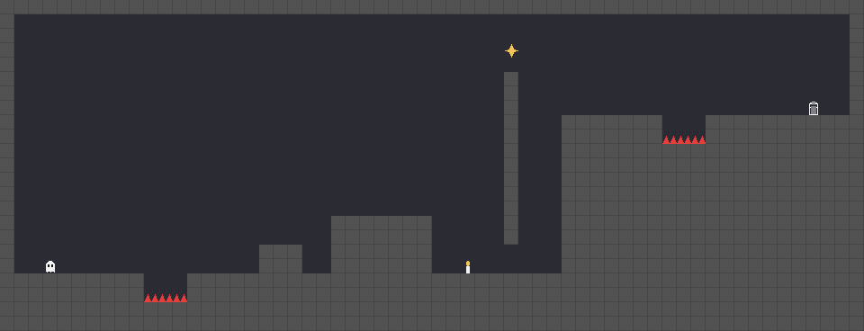
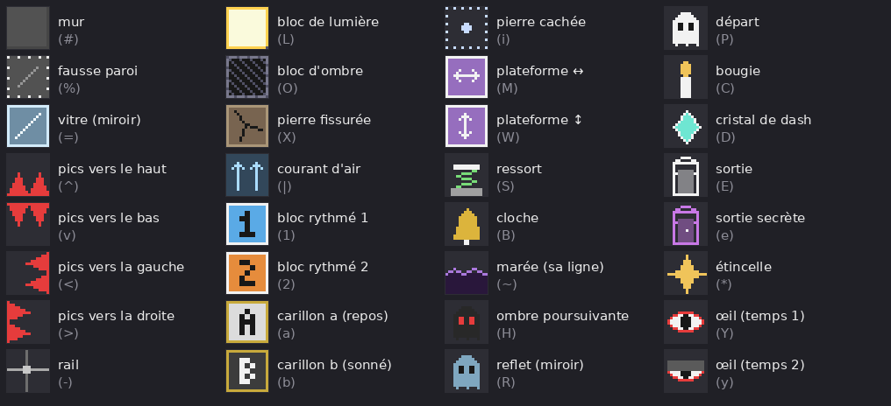
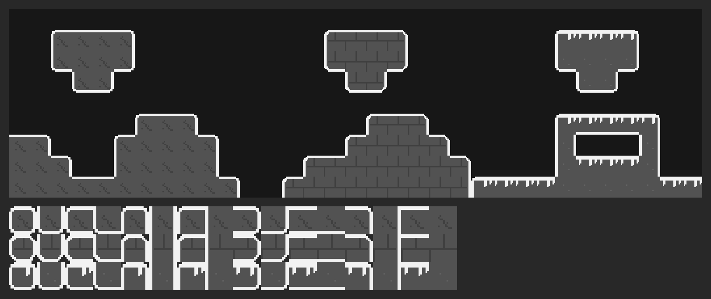
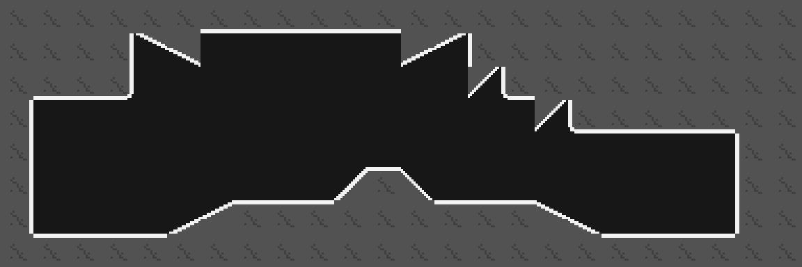

# Créer et modifier les niveaux dans l'éditeur Godot

Chaque niveau est une scène : `levels/<chapitre>/<niveau>.tscn` (par exemple
`levels/01_le_seuil/eveil.tscn`). On peint le décor dans l'éditeur, tuile par tuile, comme une
carte en mosaïque, et on pose par-dessus les **éléments réglables** (vent, plateformes mobiles,
marée…), qui ont chacun leurs propres réglages. Au lancement, le jeu relit chaque scène et construit le niveau exactement
comme avant (lumières, collisions, liserés, entités) : le rendu en jeu ne change pas, seule la
façon de dessiner change.



## Ce que contient une scène de niveau

```
Niveau        (Node2D, script levels/level.gd) : nom, chapitre, options dans l'Inspecteur
├── Carte     (TileMapLayer) : le décor, une tuile de 16 px par case
├── (Pièges…) (TileMapLayer, facultatif) : d'autres calques, pour superposer des tuiles
├── Éléments  (Node2D) : les éléments réglables (levels/elements/), chacun avec ses réglages
│   ├── Vent              (levels/elements/vent.tscn)
│   └── …
└── Indices   (Node2D)
    ├── Indice    (levels/hint.tscn) : un texte que dit l'orbe quand on approche
    └── …
```

Dans l'éditeur, un cadre orange montre le contour de la salle et un cadre blanc pâle la taille
d'un écran (480 × 270) depuis son coin en haut à gauche. Les indices affichent leur texte à côté
de leur case. Un panneau d'avertissement (triangle jaune sur « Niveau ») signale un niveau sans
nom, sans départ `P` (ou avec plusieurs), sans sortie `E`, ou des tuiles hors de la salle.

## Modifier un niveau

1. Ouvre la scène du niveau (double-clic dans le dock Système de fichiers).
2. Sélectionne le nœud **Carte** : le panneau **TileMap** s'ouvre en bas.
3. Choisis une tuile dans la palette, puis peins dans la vue 2D :
   - clic gauche : peindre ; clic droit : effacer ;
   - les outils du haut du panneau : Ligne, Rectangle, Seau (remplissage), Pipette ;
   - Maj + clic : ligne, Ctrl + Maj + clic : rectangle (raccourcis de Godot).
4. Enregistre (Ctrl + S) et lance le jeu (F5).

Une case vide (rien de peint) est du vide, comme l'ancien `.`.

### La palette



Chaque tuile correspond à un caractère de l'ancien format texte (entre parenthèses), et les
règles n'ont pas changé :

- **Salle** : le cadre orange. Par défaut, c'est le plus petit rectangle qui contient toutes
  les tuiles peintes : tu peux agrandir un niveau dans tous les sens, même au-dessus ou à
  gauche de l'origine du nœud, et la caméra suit toute seule. Pour choisir toi-même le coin,
  décoche **Auto Corner** (groupe « Salle » du nœud Niveau) et règle **Room Corner** : la case
  du coin en haut à gauche, comptée depuis la croix rouge de l'origine (case (0, 0), une case
  = 16 px ; (0, -8) est 8 cases au-dessus). **Room Size** fixe la taille depuis ce coin, (0, 0) : jusqu'aux dernières
  tuiles. Les côtés et le plafond hors de la salle comptent comme des murs ; sous la dernière
  rangée, c'est la chute ; les tuiles hors du cadre sont ignorées.
- **Départ `P`** : un seul par niveau, le fantôme apparaît sur cette case.
- **Bougie `C`, ressort `S`, sortie `E`** : posés sur le sol, dans la case juste au-dessus.
- **Cloche `B`** : la toucher inverse tous les blocs de carillon du niveau (élément
  BlocCarillon).
- **Reflet `R`** et **vitre `=`** (Miroir) : les bougies vont par paires, symétriques par
  rapport au milieu de la salle.
- **Sortie secrète `e`** : une par chapitre, cachée sous des fausses parois `%`. Elle ouvre la
  face B du chapitre.
- **Étincelle `*`** : une par niveau ; elle ouvre le fragment du journal de ce niveau.
- **Pont `p`** : une planche fine en haut de la case. Le fantôme tient dessus, mais la
  traverse en sautant par en dessous (et passe à travers de côté). Les cases de pont voisines
  sur une rangée font une seule planche. Il ne fait pas d'ombre.
### Les murs taillés : roche, pierre taillée, givre

Pour casser l'effet « cubes », trois murs de plus, toujours en gris et blanc. Ils sont solides
et font de l'ombre exactement comme le mur `#` ; seul leur dessin change (sauf le givre, qui glisse) :

- **Roche `r`** : coins saillants arrondis, quelques grains et fêlures ;
- **Pierre taillée `t`** : coins biseautés, joints de briques décalés ;
- **Givre `g`** : coins arrondis, une couche de neige qui coule en gouttes sur le dessus.
  Lui seul change aussi le jeu : **on glisse dessus**. Le fantôme y démarre et y freine
  beaucoup moins vite (il garde son élan), comme sur de la glace. Les murs et plafonds de
  givre, eux, se comportent comme les autres.

Ils sont dans le deuxième atlas de la palette (`murs.png`, à côté de la palette habituelle).
Le plus simple est de les peindre avec les terrains, pour que Godot choisisse tout seul les
bons bords et les bons coins :

1. Sélectionne **Carte**, puis l'onglet **Terrains** du panneau TileMap (à côté de « Tuiles »).
2. Choisis « Roche », « Pierre taillée » ou « Givre », et peins (Ligne, Rectangle et Seau
   marchent aussi). Les cases voisines se raccordent d'elles-mêmes ; clic droit pour effacer.

Peu importe la tuile exacte posée : en jeu, chaque case de mur taillé recalcule ses bords à
partir de ses voisins, et ses grains et gouttes varient d'une case à l'autre. On peut les
mélanger entre eux et avec `#` : deux murs qui se touchent ne se séparent pas d'un liseré.
Seuls les coins saillants sont arrondis ; les collisions restent carrées.



Pour retoucher leur dessin : `tools/make_murs.py` (l'icône dans l'éditeur, et la source
« Murs » de `levels/tiles.tres`) et `_draw_shaped` dans `scripts/tiles_drawer.gd` (le jeu).

### Les pentes

La dernière rangée de `murs.png` : des pentes pleines, en gris avec un liseré le long du biais.
Elles se posent une par une depuis l'onglet **Tuiles** (pas les terrains) :

- **Raides (45°)** : une tuile. Sol qui monte vers la droite, vers la gauche, puis les mêmes
  au plafond.
- **Douces** : une case de haut pour deux de long, donc deux tuiles côte à côte, la moitié
  basse puis la moitié haute (dans l'ordre de la palette). Au sol et au plafond.

Le fantôme y court à vitesse constante et reste collé en descente ; on ne peut pas s'y
accrocher en wall jump (seules les parois verticales comptent comme murs), et le dash glisse
le long du biais. Un mur collé au côté plein d'une pente ne montre pas de liseré de ce côté.



## Les éléments réglables

Tout ce qui bouge ou qui a des réglages n'est plus une tuile mais un **élément** : un nœud
qu'on pose dans le niveau et qu'on règle dans l'Inspecteur, un par un. Il n'y a qu'un élément
par mécanique : un seul vent (sa direction est un réglage), un seul bloc de lumière et d'ombre
(son mode est un réglage), etc.

**Poser un élément** : dans le dock Système de fichiers, ouvre `levels/elements/` et glisse la
scène de l'élément dans la vue 2D. Range-le ensuite sous le nœud **Éléments** (glisser-déposer
dans l'arbre de la scène ; ce n'est pas obligatoire, mais c'est plus clair). Le plus simple
reste souvent de dupliquer un élément déjà posé (Ctrl + D) puis de le déplacer.

**Le placer** : un élément se cale tout seul sur la grille de 16 px. Son nœud est le coin en
haut à gauche de sa première case ; **Size** donne sa taille en cases (largeur, hauteur). Dans
l'éditeur, chaque élément se dessine avec ses réglages (flèches du vent, course de la
plateforme, portée de l'œil…). Un élément hors du cadre orange est signalé par le triangle
jaune sur « Niveau ».

| Élément | Remplace | Réglages |
|---|---|---|
| **Vent** (`vent.tscn`) | `\|` `_` `(` `)` | **Size** ; **Direction** : haut, bas, gauche, droite ; **Force** : 1 = normal (vers le haut, il monte à 170 px/s ; vers le bas, 300 px/s ; de côté, il ajoute 110 px/s), 2 = deux fois plus fort. |
| **Zéro gravité** (`zero_gravite.tscn`) | `0` | **Size** ; **Freinage** de l'élan vertical (200 = normal, 0 = il ne s'éteint jamais) ; **Recharge Dash** : le dash revient dès qu'il est fini, même en l'air. |
| **Bloc lumière / ombre** (`bloc_lumiere_ombre.tscn`) | `L` `O` | **Size** ; **Mode** : Lumière (solide quand le fantôme brille, dash disponible) ou Ombre (solide quand il est éteint). |
| **Pierre fissurée** (`pierre_fissuree.tscn`) | `X` | **Size** ; **Tremble** : secondes avant la chute (0,45) ; **Retour** : secondes avant qu'elle revienne (2). |
| **Sortie** (`sortie.tscn`) | `E` | **Orientation** : Debout (comme la tuile `E`, posée sur le sol dans la case juste au-dessus, on y entre par le côté) ou Couchée (à l'horizontale, on y entre par en haut ou par en bas : posée dans un trou du plafond, c'est une sortie vers le haut) ; **Largeur** de la sortie couchée, en cases depuis la case du nœud vers la droite (2). La tuile `E` reste valable. |
| **Ressort** (`ressort.tscn`) | `S` | **Force** : vitesse de la propulsion (430). Posé dans la case juste au-dessus du sol ; l'aperçu montre à peu près la hauteur atteinte. |
| **Clé** (`cle.tscn`) | | **Numero** (1 à 4) : elle ouvre les portes du même numéro. Le fantôme la ramasse en passant, elle le suit, et ouvre la première porte de son numéro qu'il touche (posé dessus, contre elle ou dessous). S'il meurt avant, elle retourne à sa place. Une clé n'ouvre qu'une porte. |
| **Porte** (`porte.tscn`) | | **Size** (1 × 3) ; **Numero** (1 à 4). Un bloc plein qui s'efface quand une clé du même numéro la touche, et reste ouvert jusqu'à la fin du niveau, même après une mort. Le numéro est dessiné en petits points sur la clé et sur la porte. |
| **Plateforme mobile** (`plateforme.tscn`) | `M` `W` `-` | **Size** ; **Course** : le bout B en cases depuis le bout A (là où est le nœud) : (6, 0) = 6 cases à droite, (0, -4) = 4 cases plus haut, (4, -4) = en diagonale ; **Pause** à chaque bout (0,4 s) ; **Depart** : où elle est au lancement, de 0 (en A) à 1 (en B) ; **Declenchement** : Toujours (aller-retour sans fin), Fantôme dessus (attend en A que le fantôme monte, va en B puis revient seule) ou Fantôme dessus aux deux bouts ; groupe **Aller (A → B)** : **Vitesse** moyenne en px/s (60) et **Acceleration** (Constante, Douce au départ et à l'arrivée, Douce au départ, Douce à l'arrivée) ; groupe **Retour (B → A)** : **Meme Retour** (coché = mêmes réglages qu'à l'aller), sinon **Vitesse Retour** et **Acceleration Retour**. Le rail est dessiné tout seul. |
| **Bloc de carillon** (`bloc_carillon.tscn`) | `a` `b` | **Size** ; **Etat** : solide au repos, ou solide une fois sonné. Les cloches restent des tuiles `B`. |
| **Bloc rythmé** (`bloc_rythme.tscn`) | `1` `2` | **Size** ; **Temps** : solide pendant la première ou la seconde moitié du cycle. Le cycle (2,4 s) est commun au niveau, la musique le suit. |
| **Œil** (`oeil.tscn`) | `Y` `y` | **Decalage** : moment où il s'ouvre dans le cycle commun (0 = l'ancien `Y`, 0,5 = l'ancien `y`) ; **Portee** du regard en px (150). |
| **Marée** (`maree.tscn`) | `~` | Sa rangée marque où elle commence. **Vitesse** de montée en px/s (26) ; **Portee** : écart sous le fantôme au-delà duquel elle accélère (150) ; **Rattrapage** (1,6) ; **Sous Bougie** : où elle repart après une mort (96 px sous la bougie). Une seule par niveau. |
| **Ombres poursuivantes** (`ombres.tscn`) | `H` | **Nombre** d'ombres ; **Retard** de la première sur le fantôme (1,1 s) ; **Ecart** : retard en plus de chaque ombre sur la précédente ; **Vitesse** : 1 = au même pas que le fantôme, plus vite elles le rattrapent peu à peu ; **Compagne** (épilogue) : elle marche avec lui sans le toucher. Elles partent toujours du fantôme : la place du nœud ne compte pas. |

Quelques précisions sur le comportement :

- **Plateforme mobile** : la vitesse réglée est une moyenne, le trajet dure toujours course ÷
  vitesse. « Douce au départ » démarre lentement et arrive vite, « Douce à l'arrivée » l'inverse.
  Le fantôme qui saute ou tombe d'une plateforme garde son élan : il continue à sa vitesse
  jusqu'à toucher le sol, un mur, ou dasher ; si elle monte, son élan s'ajoute au saut.
- **Vent** : vers le haut, il soulève le fantôme ; vers le bas, il le plaque plus vite qu'une
  chute ; de côté, il l'emporte au sol comme en l'air, et on avance à peine contre lui. Le dash
  passe à travers sans être dévié. Deux vents opposés qui se chevauchent s'annulent (selon leur
  force).
- **Zéro gravité** : dedans, le fantôme ne tombe plus et flotte sur son élan. Avec la recharge,
  c'est la seule exception à « le dash ne revient qu'au sol » : on peut y enchaîner les dashes.
- Les réglages par défaut sont ceux d'avant : les niveaux existants ont été convertis et se
  jouent comme avant.

## Plusieurs tuiles sur une même case

Un calque (TileMapLayer) ne porte qu'une tuile par case. Pour en superposer, par exemple des pics
sous une fausse paroi, ajoute un deuxième calque (les éléments réglables, eux, se superposent
librement à tout) :

1. Sélectionne **Niveau**, puis *Ajouter un nœud enfant* (Ctrl + A) > **TileMapLayer**.
   Renomme-le (par exemple « Pièges »).
2. Dans l'Inspecteur, à **Tile Set**, choisis `levels/tiles.tres` (clic sur la flèche > *Charger*,
   ou glisse le fichier depuis le dock Système de fichiers).
3. Sélectionne ce calque et peins dedans comme dans la Carte : ses tuiles s'ajoutent à celles des
   autres calques, case par case.

Tous les calques enfants du nœud Niveau comptent, autant qu'il en faut. Le jeu réunit les tuiles
de chaque case : une tuile dans la Carte et des pics `^` dans « Pièges » font une case qui a les
deux. L'ordre des calques ne change rien en jeu.
Ne déplace pas un calque (sa position doit rester (0, 0)) : l'éditeur le signale sinon.

## Les indices

- Pour ajouter un indice : sélectionne **Indices**, puis *Instancier une scène enfant*
  (icône de chaîne, ou Ctrl + Maj + A) et choisis `levels/hint.tscn`. Place-le, et écris son
  texte dans **Text** (Inspecteur). Le plus simple reste de dupliquer un indice existant
  (Ctrl + D).
- Sa case est celle où se trouve le nœud. Deux indices sur des rangées qui se suivent sont dits
  ensemble, l'un après l'autre.
- `{jump}`, `{dash}`, `{left}`, `{right}` affichent les touches choisies par le joueur.

## Les réglages du niveau (nœud Niveau, Inspecteur)

| Réglage | Rôle |
|---|---|
| **Level Name** | Nom affiché. Il sert aussi de clé à la sauvegarde : le changer remet records et étincelles du niveau à zéro. |
| **Chapter** | Chapitre (musique, carte d'ouverture, écran des chapitres). Un nouveau chapitre s'ajoute à la liste en haut de `levels/level.gd`, et a besoin d'un thème dans `music_themes.gd` et d'une vignette dans `illustrations.gd`. |
| **Bside** / **Line** | Face B du chapitre, et sa phrase sur la carte d'ouverture. |
| **Epilogue** / **Colors** | Niveau de l'épilogue, et sa teinte de 0 (noir et blanc) à 1. |
| **Auto Corner** / **Room Corner** | Coin en haut à gauche de la salle : automatique (tuile la plus en haut à gauche), ou la case choisie. |
| **Room Size** | Taille de la salle en cases depuis son coin ; (0, 0) : automatique. |

## Tester un niveau sans repasser par le début

Ouvre la scène du niveau et appuie sur **F6** (« Lancer la scène actuelle », en haut à droite) :
le jeu s'ouvre directement dans ce niveau, relu depuis le disque, donc avec tes dernières
modifications. Ça marche pour les niveaux de l'histoire comme pour l'Ascension, à condition que
le niveau soit déjà dans sa liste (`levels/list.tres` ou `levels/ascension/list.tres`).

Pour partir d'ailleurs que du départ `P` (utile en haut du Phare) : ajoute sous le nœud racine un
**Marker2D** nommé exactement `DepartTest`, et place-le là où le fantôme doit apparaître (juste
au-dessus d'un sol). Il ne sert qu'à F6 : le jeu normal l'ignore, tu peux le laisser dans la scène.
Les temps faits en test ne comptent pas dans les records.

## Ajouter un niveau

1. Dans le dock Système de fichiers, duplique `levels/modele.tscn` (une salle d'un écran avec
   un départ, une sortie et un indice) ou un niveau proche : clic droit > *Dupliquer…*, et
   range-le dans le dossier de son chapitre.
2. Ouvre-le, sélectionne **Niveau** et change **Level Name** et **Chapter**.
3. Ouvre `levels/list.tres` : c'est l'ordre des niveaux du jeu. Dans l'Inspecteur, ajoute un
   élément au tableau **Levels**, glisse ta scène dedans, puis place-la au bon endroit
   (glisser-déposer par la poignée à gauche de chaque ligne).
   L'ordre attendu : les chapitres, puis l'épilogue, puis les faces B.

Un niveau qui n'est pas dans `levels/list.tres` n'apparaît pas dans le jeu.

**Changer l'ordre** ne fait rien perdre : la sauvegarde retrouve records et étincelles par le nom
du niveau. Attention au journal : les fragments de `scripts/lore.gd` suivent l'ordre des niveaux
(fragment n° i = étincelle du niveau i), donc insérer un niveau au milieu décale les fragments
suivants ; il faut alors insérer un fragment au même endroit.

## Pour aller plus loin

- La palette (`levels/tiles.png`) se régénère avec `python3 tools/make_tiles.py levels/tiles.png`.
  L'ordre des icônes doit rester celui de `CHARS` dans `levels/level.gd`.
- Une nouvelle sorte de tuile (décor sans réglage) : ajouter son icône à la fin de
  `tools/make_tiles.py`, son caractère à la fin de `CHARS`, la tuile dans `levels/tiles.tres`
  (éditeur de TileSet : clic sur la case de l'atlas), puis son cas dans `scripts/main.gd`
  (`_load_level`).
- Un nouvel élément réglable : un script dans `levels/elements/` qui étend `LevelElement`
  (`element.gd`), avec ses réglages en `@export`, son aperçu dans `_draw()` et ses réglages
  pour le jeu dans `element_data()` (un dictionnaire avec un `"type"`) ; une scène `.tscn` d'un
  seul nœud avec ce script ; puis son cas dans `scripts/main.gd` (`_add_elements`).

## Le mode Ascension

L'Ascension est un mode à part, ouvert depuis l'écran titre (« Ascension »). Le jeu principal
ne change pas. Ses niveaux sont rangés dans `levels/ascension/`, dans l'ordre de
`levels/ascension/list.tres`, et ils se peignent exactement comme les autres. Ils ne comptent ni
dans la partie, ni dans les chapitres, ni dans le journal. Leurs records sont gardés à part, par
nom de niveau.

La physique y est différente (`scripts/physique/Player.cs`, `AscentProcess`) :

- **pas de dash ni de wall jump** ;
- au sol, on marche lentement ; **maintenir saut charge le saut** (le fantôme se tasse). La
  charge plafonne à 1 s, mais le fantôme ne part qu'au relâcher : la visée compte jusque-là. **Gauche et droite comptent en pourcentage de la
  charge** : tenir droite pendant toute la charge (courte ou longue) donne 100 % d'élan à
  droite, la moitié du temps 50 %, et tenir gauche retire autant ; sans rien tenir, il saute
  tout droit. La visée règle l'angle (jusqu'à 60° depuis la verticale, `AscentMaxAngle`) : la
  force du saut se partage entre la hauteur et le côté. Plus la charge est longue, plus il saute haut (jusqu'à
  environ 8 cases) ;
- **en l'air, plus aucun contrôle** ;
- **un mur renvoie le fantôme** dans l'autre sens, en gardant presque tout son élan ; un plafond le
  fait retomber ;
- tomber ne tue pas : on retombe plus bas et il faut tout remonter. Les niveaux doivent donc
  avoir un **sol tout en bas**. À l'atterrissage, le fantôme **s'écrase au sol** dès 2 cases de chute :
  plus la chute est haute, plus il s'aplatit et plus il met de temps à se relever (jusqu'à
  0,9 s, sans pouvoir bouger), avec de la poussière qui gicle (constantes `Splat…`). Une chute de plus de 6 cases secoue l'écran et compte comme
  une « chute » (affichée avec le temps).

**La caméra ne défile pas** : le niveau est découpé en écrans fixes, comptés depuis le bas.
La caméra y est reculée (`ASCENT_ZOOM` = 0,8 dans `scripts/main.gd` et `levels/level.gd`) : un
écran montre 600 × 338 px du monde (37,5 × 21 cases). Une salle moins large qu'un écran est
centrée, on voit un peu le décor de chaque côté. Dès que le fantôme passe le haut d'un écran, on bascule d'un coup
sur celui du dessus (et inversement en tombant). Le dernier écran est calé sur le haut de la
salle, donc il chevauche un peu le précédent. Dans l'éditeur, les scènes de `levels/ascension/`
montrent ces limites en bleu, avec le numéro de chaque écran : on y voit tout de suite un saut
qui se fait à cheval sur deux écrans.

L'option **Debug · trajectoire du saut** (Options) montre pendant la charge un trait dans la
direction du saut et la courbe qu'il suivrait, sans tenir compte des murs.

Les réglages (hauteur, portée, temps de charge, rebond) sont les constantes `Ascent…` en haut de
`Player.cs`. Repère pour dessiner : tout droit à pleine charge, le fantôme monte d'environ 8 cases ; à
60°, il ne monte plus que de 2 cases mais file d'une quinzaine de cases sur le côté. Les pics marchent encore, mais une mort
ramène au départ `P` : à utiliser avec parcimonie.

### Le Phare

L'Ascension tient en un seul grand niveau, `levels/ascension/phare.tscn` (30 × 280 cases, une
quinzaine d'écrans), en dix zones du bas vers le haut, de plus en plus dures :

1. **Les racines** (roche `r`) : sol bosselé, corniches dans les parois, un surplomb ;
2. **La tour** (pierre taillée `t`) : paliers en quinconce, une cheminée étroite où l'on rebondit
   d'une paroi à l'autre, un plancher troué qui renvoie tout en bas ;
3. **Les éboulis** : des **pentes raides** (`j`, `k`). En Ascension, une pente à 45° n'est pas un
   sol : on y glisse en prenant de la vitesse (`AscentFloorAngle`, `AscentSlideMax`), et au bout
   on est projeté dans le prolongement de la pente : il faut viser les replats ;
4. **Le vent** : deux éléments Vent, une rafale vers la gauche puis une vers la droite, qui
   dévient le fantôme en l'air (`AscentWindAccel`) ;
5. **Le givre** (`g`) : les corniches glissent, le fantôme continue sur son élan en atterrissant ;
   au-dessus, la tour continue :
6. **Les ressorts** : un ressort sur l'ancien sommet, puis des **pierres fissurées** qui tombent
   vite : pas le temps de charger un grand saut dessus, il faut enchaîner de petits sauts ;
7. **L'horloge** : des **blocs rythmés** en alternance, à prendre au bon temps (la charge dure
   jusqu'à 1 s, le bloc reste 1,2 s) ;
8. **Le carillon** : la **cloche** est sur la corniche de gauche ; une fois sonnée, la marche du
   bas disparaît et les marches qui montent apparaissent ;
9. **La clé** : une **trappe** (porte) ferme le haut de la salle ; la clé attend sur une
   corniche à gauche. Tomber ne la fait pas perdre ;
10. **La lanterne** : une bulle **sans pesanteur** (le fantôme flotte sur son élan), du givre,
    et la sortie tout en haut à gauche.

Sur le **givre**, le fantôme garde son élan en atterrissant, même écrasé ; dès qu'il charge un
saut, il se cale et ne glisse plus.
