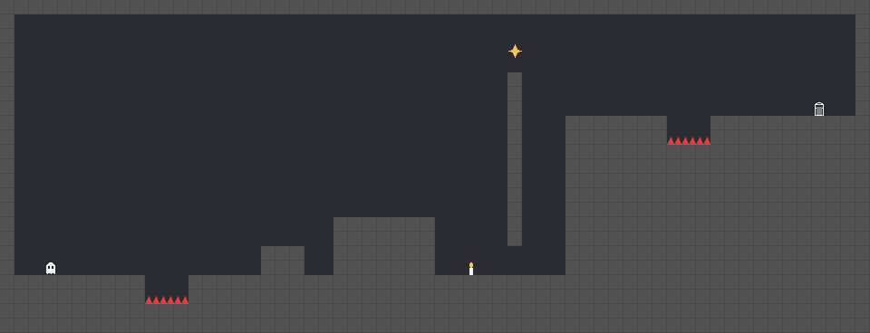
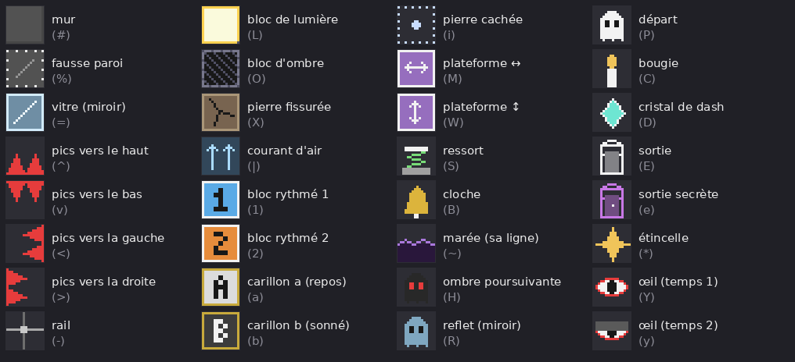
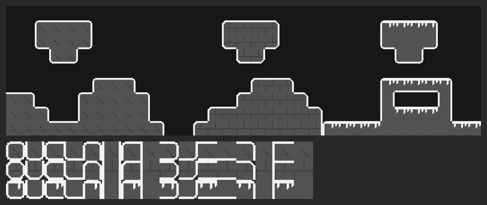

# Créer et modifier les niveaux dans l'éditeur Godot

Chaque niveau est une scène : `levels/<chapitre>/<niveau>.tscn` (par exemple
`levels/01_le_seuil/eveil.tscn`). On la peint dans l'éditeur, tuile par tuile, comme une
carte en mosaïque. Au lancement, le jeu relit chaque scène et construit le niveau exactement
comme avant (lumières, collisions, liserés, entités) : le rendu en jeu ne change pas, seule la
façon de dessiner change.



## Ce que contient une scène de niveau

```
Niveau        (Node2D, script levels/level.gd) : nom, chapitre, options dans l'Inspecteur
├── Carte     (TileMapLayer) : toute la carte, une tuile de 16 px par case
└── Indices   (Node2D)
    ├── Indice    (levels/hint.tscn) : un texte que dit l'orbe quand on approche
    └── …
```

Dans l'éditeur, un cadre orange montre le contour de la salle et un cadre blanc pâle la taille
d'un écran (480 × 270) depuis son coin en haut à gauche. Les indices affichent leur texte à côté
de leur case. Un panneau d'avertissement (triangle jaune sur « Niveau ») signale un niveau sans
nom, sans départ `P` (ou avec plusieurs), sans sortie `E`, ou des tuiles hors de la salle.

## Modifier un niveau

1. Ouvre la scène du niveau (double-clic dans le dock Système de fichiers).
2. Sélectionne le nœud **Carte** : le panneau **TileMap** s'ouvre en bas.
3. Choisis une tuile dans la palette, puis peins dans la vue 2D :
   - clic gauche : peindre ; clic droit : effacer ;
   - les outils du haut du panneau : Ligne, Rectangle, Seau (remplissage), Pipette ;
   - Maj + clic : ligne, Ctrl + Maj + clic : rectangle (raccourcis de Godot).
4. Enregistre (Ctrl + S) et lance le jeu (F5).

Une case vide (rien de peint) est du vide, comme l'ancien `.`.

### La palette



Chaque tuile correspond à un caractère de l'ancien format texte (entre parenthèses), et les
règles n'ont pas changé :

- **Salle** : le cadre orange. Par défaut, c'est le plus petit rectangle qui contient toutes
  les tuiles peintes : tu peux agrandir un niveau dans tous les sens, même au-dessus ou à
  gauche de l'origine du nœud, et la caméra suit toute seule. Pour choisir toi-même le coin,
  décoche **Auto Corner** (groupe « Salle » du nœud Niveau) et règle **Room Corner** : la case
  du coin en haut à gauche, comptée depuis la croix rouge de l'origine (case (0, 0), une case
  = 16 px ; (0, -8) est 8 cases au-dessus). **Room Size** fixe la taille depuis ce coin, (0, 0) : jusqu'aux dernières
  tuiles. Les côtés et le plafond hors de la salle comptent comme des murs ; sous la dernière
  rangée, c'est la chute ; les tuiles hors du cadre sont ignorées.
- **Départ `P`** : un seul par niveau, le fantôme apparaît sur cette case.
- **Bougie `C`, ressort `S`, sortie `E`** : posés sur le sol, dans la case juste au-dessus.
- **Plateformes mobiles `M` / `W`** : une plateforme de plusieurs cases se peint en plusieurs
  tuiles côte à côte ; sa course est faite des rails `-` qui la prolongent (à gauche et à
  droite pour `M`, au-dessus et au-dessous pour `W`).
- **Marée `~`** : une seule tuile suffit, sa rangée marque où la marée commence.
- **Ombre `H`** : sa présence dans le niveau suffit, elle part du fantôme.
- **Reflet `R`** et **vitre `=`** (Miroir) : les bougies vont par paires, symétriques par
  rapport au milieu de la salle.
- **Sortie secrète `e`** : une par chapitre, cachée sous des fausses parois `%`. Elle ouvre la
  face B du chapitre.
- **Étincelle `*`** : une par niveau ; elle ouvre le fragment du journal de ce niveau.

### Les murs taillés : roche, pierre taillée, givre

Pour casser l'effet « cubes », trois murs de plus, toujours en gris et blanc. Ils sont solides
et font de l'ombre exactement comme le mur `#` ; seul leur dessin change :

- **Roche `r`** : coins saillants arrondis, quelques grains et fêlures ;
- **Pierre taillée `t`** : coins biseautés, joints de briques décalés ;
- **Givre `g`** : coins arrondis, une couche de neige qui coule en gouttes sur le dessus.

Ils sont dans le deuxième atlas de la palette (`murs.png`, à côté de la palette habituelle).
Le plus simple est de les peindre avec les terrains, pour que Godot choisisse tout seul les
bons bords et les bons coins :

1. Sélectionne **Carte**, puis l'onglet **Terrains** du panneau TileMap (à côté de « Tuiles »).
2. Choisis « Roche », « Pierre taillée » ou « Givre », et peins (Ligne, Rectangle et Seau
   marchent aussi). Les cases voisines se raccordent d'elles-mêmes ; clic droit pour effacer.

Peu importe la tuile exacte posée : en jeu, chaque case de mur taillé recalcule ses bords à
partir de ses voisins, et ses grains et gouttes varient d'une case à l'autre. On peut les
mélanger entre eux et avec `#` : deux murs qui se touchent ne se séparent pas d'un liseré.
Seuls les coins saillants sont arrondis ; les collisions restent carrées.



Pour retoucher leur dessin : `tools/make_murs.py` (l'icône dans l'éditeur, et la source
« Murs » de `levels/tiles.tres`) et `_draw_shaped` dans `scripts/tiles_drawer.gd` (le jeu).

## Les indices

- Pour ajouter un indice : sélectionne **Indices**, puis *Instancier une scène enfant*
  (icône de chaîne, ou Ctrl + Maj + A) et choisis `levels/hint.tscn`. Place-le, et écris son
  texte dans **Text** (Inspecteur). Le plus simple reste de dupliquer un indice existant
  (Ctrl + D).
- Sa case est celle où se trouve le nœud. Deux indices sur des rangées qui se suivent sont dits
  ensemble, l'un après l'autre.
- `{jump}`, `{dash}`, `{left}`, `{right}` affichent les touches choisies par le joueur.

## Les réglages du niveau (nœud Niveau, Inspecteur)

| Réglage | Rôle |
|---|---|
| **Level Name** | Nom affiché. Il sert aussi de clé à la sauvegarde : le changer remet records et étincelles du niveau à zéro. |
| **Chapter** | Chapitre (musique, carte d'ouverture, écran des chapitres). Un nouveau chapitre s'ajoute à la liste en haut de `levels/level.gd`, et a besoin d'un thème dans `music_themes.gd` et d'une vignette dans `illustrations.gd`. |
| **Bside** / **Line** | Face B du chapitre, et sa phrase sur la carte d'ouverture. |
| **Epilogue** / **Colors** | Niveau de l'épilogue, et sa teinte de 0 (noir et blanc) à 1. |
| **Companion** | L'ombre `H` marche avec le fantôme sans le toucher. |
| **Auto Corner** / **Room Corner** | Coin en haut à gauche de la salle : automatique (tuile la plus en haut à gauche), ou la case choisie. |
| **Room Size** | Taille de la salle en cases depuis son coin ; (0, 0) : automatique. |

## Ajouter un niveau

1. Dans le dock Système de fichiers, duplique `levels/modele.tscn` (une salle d'un écran avec
   un départ, une sortie et un indice) ou un niveau proche : clic droit > *Dupliquer…*, et
   range-le dans le dossier de son chapitre.
2. Ouvre-le, sélectionne **Niveau** et change **Level Name** et **Chapter**.
3. Ouvre `levels/list.tres` : c'est l'ordre des niveaux du jeu. Dans l'Inspecteur, ajoute un
   élément au tableau **Levels**, glisse ta scène dedans, puis place-la au bon endroit
   (glisser-déposer par la poignée à gauche de chaque ligne).
   L'ordre attendu : les chapitres, puis l'épilogue, puis les faces B.

Un niveau qui n'est pas dans `levels/list.tres` n'apparaît pas dans le jeu.

**Changer l'ordre** ne fait rien perdre : la sauvegarde retrouve records et étincelles par le nom
du niveau. Attention au journal : les fragments de `scripts/lore.gd` suivent l'ordre des niveaux
(fragment n° i = étincelle du niveau i), donc insérer un niveau au milieu décale les fragments
suivants ; il faut alors insérer un fragment au même endroit.

## Pour aller plus loin

- La palette (`levels/tiles.png`) se régénère avec `python3 tools/make_tiles.py levels/tiles.png`.
  L'ordre des icônes doit rester celui de `CHARS` dans `levels/level.gd`.
- Une nouvelle sorte de tuile : ajouter son icône à la fin de `tools/make_tiles.py`, son
  caractère à la fin de `CHARS`, la tuile dans `levels/tiles.tres` (éditeur de TileSet : clic sur
  la case de l'atlas), puis son cas dans `scripts/main.gd` (`_load_level`).
